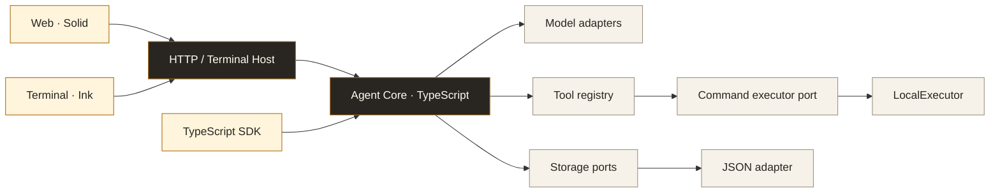

> Agent core now lives in the private [Otto repository](https://github.com/Pixeldooooog/otto). Building Kevin requires Otto read access. See [setup and CI credentials](docs/otto-dependency.md).

<a id="top"></a>

<p align="center">
  <picture>
    <source media="(prefers-color-scheme: dark)" srcset="assets/kevin-banner-handdrawn-v1-dark.svg">
    
  </picture>
</p>

<h3 align="center">An open-source personal AI agent for code, research, and everyday work.</h3>

<p align="center">
  <a href="https://github.com/Pixeldooooog/Kevin/actions/workflows/ci.yml"></a>
  <a href="https://www.typescriptlang.org/"></a>
  <a href="https://bun.sh/"></a>
  <a href="LICENSE"></a>
  
</p>

<p align="center">
  <b>English</b> · <a href="README.zh-CN.md">简体中文</a>
  <br>
  <a href="#quick-start">Quick start</a> · <a href="#what-you-can-build-on">Capabilities</a> · <a href="#architecture">Architecture</a> · <a href="#roadmap">Roadmap</a> · <a href="#documentation">Docs</a> · <a href="#contributing">Contributing</a>
</p>

<br>

<table>
  <tr>
    <td width="33%" valign="top">
      <h4>Run locally</h4>
      Kevin runs on your machine and the host binds to <code>127.0.0.1</code>. Model requests go only to the endpoint you configure.
    </td>
    <td width="33%" valign="top">
      <h4>Bring your model</h4>
      Switch OpenAI, Claude, or compatible endpoints with a named profile. Gemini currently supports text only.
    </td>
    <td width="33%" valign="top">
      <h4>Inspect the work</h4>
      Tool calls surface as reviewable events, governed by allow/deny rules and explicit approval requests.
    </td>
  </tr>
</table>

Kevin is being built as a personal agent that works with your files, tools, and projects. The goal is one place to hand off work, review progress, and carry useful context forward.

Today, the repository provides a TypeScript agent runtime, a browser interface, a terminal interface, and an SDK. The current focus is completing the execution and persistence foundation before expanding the personal product.

> [!NOTE]
> **Development preview.** Durable task recovery, Markdown-based personal memory, and background routines are still on the roadmap. Native sandbox backends are deferred; current local commands run with the host process's permissions. See the [support matrix](docs/baseline/support-matrix.md) for the tested scope.

## Work alongside Kevin

An antenna dog and a calm place to work. Warm paper, ink-colored text, and a touch of amber give conversations and progress a familiar home, with an expressive character and readable content.

<p align="center"></p>

<p align="center"><sub>Artifact workspace design preview · Sample data, not a live model run.</sub></p>

## Quick start

You need **Git**, **[Bun 1.4.4](https://bun.sh/)**, and credentials for a supported model provider. Start on macOS or Linux; Windows command execution is not enabled yet. Docker is optional.

### ① Get the source

```bash
git clone https://github.com/Pixeldooooog/Kevin.git kevin
cd kevin
bun run setup
cp .env.example .env
```

### ② Configure a model

Edit `.env` with a key and a model ID available to your account:

```dotenv
OPENAI_API_KEY=your-api-key
OPENAI_MODEL=your-model-id
```

For an OpenAI-compatible endpoint, also set `OPENAI_BASE_URL`. See [configuration](docs/configuration.md) for other providers and named profiles. Local execution does not mean offline inference: model requests go to the endpoint you configure.

### ③ Open Kevin

```bash
bun run web
```

Open **[http://127.0.0.1:8020/ui/](http://127.0.0.1:8020/ui/)**.

For the terminal interface, run this instead:

```bash
bun run tui
```

The terminal provides `/status`, `/model`, `/sessions`, and `/resume`. Client behavior is still being consolidated around the shared runtime; see the [baseline plan](docs/agent-system-baseline.md).

### Try a first task

Start with a concrete request whose result you can review:

> Summarize this repository's entrypoints and explain how a message reaches the model. Include the relevant file paths.

Then try a scoped change:

> Find one small bug, explain it, make the smallest fix, and run the relevant tests. Show me the diff and test results.

## What you can build on

<table>
  <tr>
    <td width="50%" valign="top">
      <h4>Work with a repository</h4>
      Read and edit files, search code, apply patches, inspect Git changes, and run commands or tests.
    </td>
    <td width="50%" valign="top">
      <h4>Choose your model</h4>
      Adapters for OpenAI Chat Completions, OpenAI Responses, and Claude Messages, plus named compatible profiles. Gemini currently supports text only, without tool calls.
    </td>
  </tr>
  <tr>
    <td valign="top">
      <h4>Review execution</h4>
      Tool events, enabled/denied tool rules, and explicit approval requests in the runtime.
    </td>
    <td valign="top">
      <h4>Keep execution bounded</h4>
      Finite tool loops, validated tool parameters, capped command output, timeouts, and command cancellation through runtime signals.
    </td>
  </tr>
  <tr>
    <td valign="top">
      <h4>Extend the workflow</h4>
      Built-in tools for web retrieval, skills, MCP resources/prompts, tasks, and workspace operations; TypeScript SDK and HTTP entrypoints.
    </td>
    <td valign="top">
      <h4>120 built-in tools</h4>
      Registration and local tests do not establish full integration support: provider credentials, external services, and individual tool behavior still need validation in the target environment.
    </td>
  </tr>
</table>

## Interface & design

The live chat includes the warm-paper theme, dog avatar, and session states. The artifact workspace above explores the design direction; the personal conversation experience is still evolving.

<details>
<summary><strong>Explore the prototypes and character assets</strong></summary>

- After starting the Web UI, visit `/ui/?design` for character states, components, and light/dark palettes.
- Visit `/ui/?design=workspace` to explore sources, draft editing, and review actions. This prototype uses sample data and never calls models or tools.
- [Design specification](docs/design/kevin-ui.md): character, components, motion, and integration boundaries.
- [Antenna dog asset kit](assets/kevin-kit/v1/README.md): static illustrations for listening, thinking, working, approval, and more.

</details>

## Execution and data

| | Today's behavior |
| --- | --- |
| 🔒 **Local by default** | The HTTP host binds to `127.0.0.1`. Non-loopback binding requires `ACCESS_TOKEN`; browser origins must be explicitly allowed. |
| ⚠️ **Host execution** | Local commands can access the host's files, network, and inherited environment. Requests requiring isolation fail closed. Platform sandbox adapters are reserved for a later release. |
| ⏱️ **Bounded commands** | Commands default to **30 s** with a **120 s** ceiling. stdout and stderr each retain up to **128 KiB**; larger results are explicitly marked as truncated. |
| 💾 **Current storage** | Runs and tasks use a JSON store. SQLite has a feasibility spike, but a production adapter, crash recovery, and durable scheduling are not integrated yet. |

Read the [execution decision record](docs/baseline/adr-001-local-execution.md) and [configuration reference](docs/configuration.md) before changing deployment or execution settings.

## Architecture



The core owns model turns, tool dispatch, execution contracts, and storage interfaces. Clients provide interaction; the host assembles services. Native sandbox backends and durable storage plug into dedicated interfaces as they are implemented.

<details>
<summary><strong>Repository layout</strong></summary>

```text
apps/
  web/         Browser interface
  terminal/    Terminal interface
packages/
  core/        Runtime, SDK, models, tools, contracts, and storage ports
  host/        HTTP API and terminal host
config/        Runtime defaults
docs/          Architecture, product plan, and verification evidence
scripts/       Baseline inventory and feasibility checks
deploy/        Optional container deployment
```

</details>

## Roadmap

| Phase | Focus | Status |
| --- | --- | --- |
| **B0 — Foundation** | Capability mapping, versioned contracts, storage ports, safe defaults | <br><sub>First implementation and evidence available</sub> |
| **B1 — Reliable execution** | Model/tool behavior, authorization, bounds, and cancellation |  |
| **B2 — Durable work** | SQLite, task ownership, action ledger, recovery, budgets, and scheduling |  |
| **B3 — Complete baseline** | Markdown memory, artifacts, client consistency, and integration acceptance |  |
| **P1–P3 — Personal product** | Identity, goals, routines, interaction, and distribution |  |
| **C1 — Cloud execution** | Separate remote worker and control-plane architecture |  |

Native sandbox backends are **deferred independently** and do not block the remaining baseline work. Current local execution is not advertised as sandboxed.

See the [implementation roadmap](docs/kevin-implementation-roadmap.md) for dependencies and acceptance criteria, and the [product architecture](docs/kevin-product-architecture-plan.md) for Kevin's longer-term direction.

## Documentation

| Start here | Go deeper |
| --- | --- |
| [Quickstart](docs/quickstart.md) | [System baseline](docs/agent-system-baseline.md) |
| [Configuration](docs/configuration.md) | [Architecture](docs/architecture.md) |
| [Support matrix](docs/baseline/support-matrix.md) | [Module map](docs/module-map.md) |
| [Implementation evidence](docs/baseline/b1-execution-evidence.md) | [Python → TypeScript migration](docs/typescript-migration-plan.md) |

## Contributing

Kevin is under active development. Useful contributions include reproducible bugs, focused fixes, provider compatibility checks, and missing baseline tests.

1. Read the [engineering guidelines](AGENTS.md) and [baseline plan](docs/agent-system-baseline.md) and choose a bounded change.
2. Keep client/host wiring thin; put behavior in the relevant core domain module. Start commit messages with an emoji, for example `📝 Refine README layout`.
3. Run `bun run check` and describe what you verified. Distinguish fixture tests from real-provider or platform validation.
4. Open a [pull request](https://github.com/Pixeldooooog/Kevin/pulls) with the problem, change, and evidence. Use [issues](https://github.com/Pixeldooooog/Kevin/issues) for bugs and proposals.

<details>
<summary><strong>Development commands</strong></summary>

```bash
bun run host          # HTTP host without rebuilding the web UI
bun run tui           # Terminal interface
bun run web           # Build and serve the web UI
bun run test          # Core and host tests
bun run test-terminal # Terminal checks and smoke tests
bun run check         # Type checks, web build, tests, and terminal checks
```

For frontend development, configure `CORS_ORIGINS=http://localhost:5173,http://127.0.0.1:5173` for the host, then run `bun run dev-web`.

</details>

## License

[MIT](LICENSE).

<p align="right"><a href="#top">Back to top ↑</a></p>
