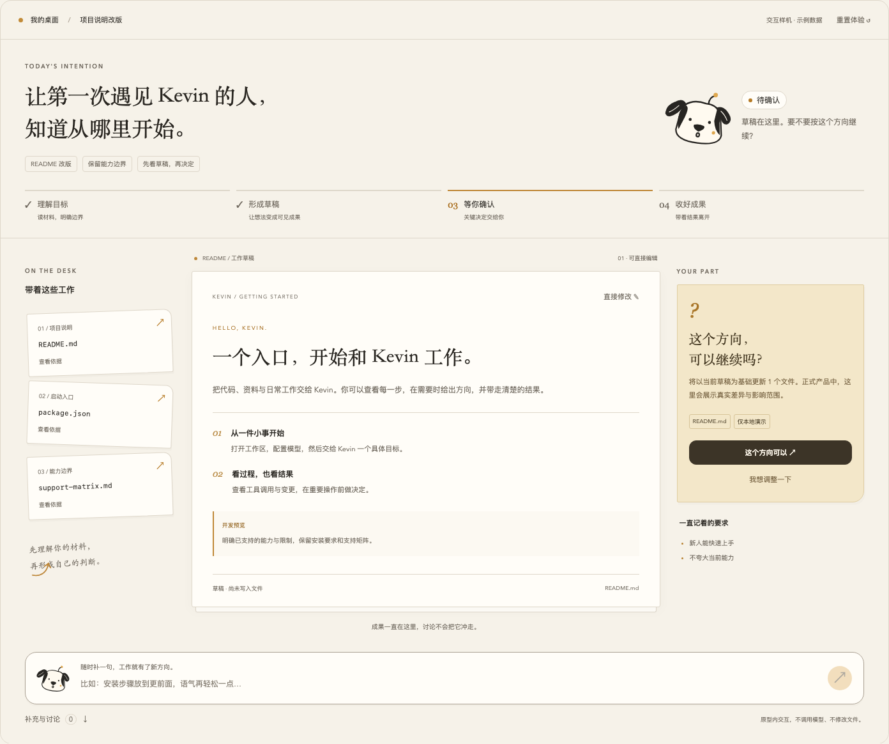
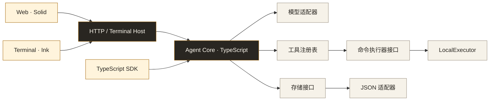

<a id="top"></a>

<p align="center">
  <picture>
    <source media="(prefers-color-scheme: dark)" srcset="assets/kevin-banner-dark.svg">
    
  </picture>
</p>

<h3 align="center">面向代码、资料与日常工作的开源个人智能体。</h3>

<p align="center">
  <a href="https://github.com/Pixeldooooog/Kevin/actions/workflows/ci.yml"></a>
  <a href="https://www.typescriptlang.org/"></a>
  <a href="https://bun.sh/"></a>
  <a href="LICENSE"></a>
  
</p>

<p align="center">
  <a href="README.md">English</a> · <b>简体中文</b>
  <br>
  <a href="#快速开始">快速开始</a> · <a href="#现有能力">现有能力</a> · <a href="#架构">架构</a> · <a href="#路线图">路线图</a> · <a href="#文档">文档</a> · <a href="#参与贡献">参与贡献</a>
</p>

<br>

<table>
  <tr>
    <td width="33%" valign="top">
      <h4>本地运行</h4>
      Kevin 运行在你的机器上，Host 默认监听 <code>127.0.0.1</code>。模型请求只发送到你配置的服务地址。
    </td>
    <td width="33%" valign="top">
      <h4>自选模型</h4>
      通过命名配置切换 OpenAI、Claude 或兼容服务；Gemini 当前仅支持文本。
    </td>
    <td width="33%" valign="top">
      <h4>过程可查</h4>
      工具调用以事件形式呈现，受启用/禁用规则与显式审批请求约束。
    </td>
  </tr>
</table>

Kevin 正在成为一个围绕你的文件、工具和项目工作的个人智能体。你可以在同一个地方交办工作、查看进展，并逐步积累可以继续使用的项目上下文。

当前仓库提供 TypeScript 智能体运行时、Web 界面、终端界面与 SDK。现阶段先补齐执行与持久化基线，再完善个人产品体验。

> [!NOTE]
> **开发预览阶段。** 持久任务恢复、基于 Markdown 的个人记忆、后台例行工作仍在规划与开发中。原生沙箱后端暂缓上线；当前本地命令以宿主进程权限执行。已验证范围见[支持矩阵](docs/baseline/support-matrix.md)。

## 和 Kevin 一起工作

一只天线狗，一个安静的工作区。用暖纸色、墨黑文字和少量琥珀色呈现对话与工作进展，让角色有表情，让内容易读。

<p align="center"></p>

<p align="center"><sub>成果工作台设计预览 · 使用示例数据，并非实际模型执行截图。</sub></p>

## 快速开始

准备 **Git**、**[Bun 1.4.4](https://bun.sh/)** 和受支持模型服务的凭据。建议从 macOS 或 Linux 开始；Windows 命令执行尚未启用。本地使用不要求 Docker。

### ① 获取代码

```bash
git clone https://github.com/Pixeldooooog/Kevin.git kevin
cd kevin
bun install --frozen-lockfile
cp .env.example .env
```

### ② 配置模型

编辑 `.env`，填入你的 API key 和账号可用的模型 ID：

```dotenv
OPENAI_API_KEY=your-api-key
OPENAI_MODEL=your-model-id
```

使用 OpenAI-compatible 服务时，再设置 `OPENAI_BASE_URL`。其他服务和命名模型配置见[配置说明](docs/configuration.md)。本地运行不等于离线推理：模型请求会发送到你配置的服务地址。

### ③ 打开 Kevin

```bash
bun run web
```

浏览器访问 **[http://127.0.0.1:8020/ui/](http://127.0.0.1:8020/ui/)**。

如果希望使用终端界面，改为运行：

```bash
bun run tui
```

终端提供 `/status`、`/model`、`/sessions` 和 `/resume` 等命令。各客户端与共享运行时的行为仍在统一中，详见[基线计划](docs/agent-system-baseline.md)。

### 试一个具体任务

先从容易核对结果的请求开始：

> 梳理这个仓库的入口，解释一条消息如何到达模型，并列出相关文件路径。

然后尝试有明确范围的修改：

> 找一个小问题，解释原因，做最小修复并运行相关测试。最后展示 diff 和测试结果。

## 现有能力

<table>
  <tr>
    <td width="50%" valign="top">
      <h4>围绕代码仓库工作</h4>
      读取和编辑文件、搜索代码、应用补丁、查看 Git 变更，以及运行命令和测试。
    </td>
    <td width="50%" valign="top">
      <h4>选择适合的模型</h4>
      适配 OpenAI Chat Completions、OpenAI Responses 与 Claude Messages；支持命名的兼容服务配置。Gemini 当前仅支持文本，不支持工具调用。
    </td>
  </tr>
  <tr>
    <td valign="top">
      <h4>查看和审批执行</h4>
      运行时提供工具事件、工具启用/禁用规则和显式审批请求。
    </td>
    <td valign="top">
      <h4>限制执行开销</h4>
      有限工具循环、参数校验、命令输出上限、超时，以及通过运行时信号取消命令。
    </td>
  </tr>
  <tr>
    <td valign="top">
      <h4>扩展工作方式</h4>
      内置 Web 检索、Skill、MCP 资源/提示词、任务和工作空间操作，并提供 TypeScript SDK 与 HTTP 入口。
    </td>
    <td valign="top">
      <h4>120 个内置工具</h4>
      存在注册和本地测试不代表完整集成已经验收；模型账号、外部服务和具体工具行为仍需在目标环境验证。
    </td>
  </tr>
</table>

## 界面与设计

实际对话页已接入暖纸主题、狗狗头像与会话状态。上方成果工作台用于展示设计方向；个人对话体验仍在完善。

<details>
<summary><strong>探索原型与角色素材</strong></summary>

- 启动 Web 后访问 `/ui/?design`，查看角色状态、组件和浅深配色。
- 访问 `/ui/?design=workspace`，体验材料展开、改稿与确认流程。该原型使用示例数据，不调用模型或工具。
- [设计规范](docs/design/kevin-ui.md)：角色、组件、动效与接入边界。
- [天线狗素材包](assets/kevin-kit/v1/README.md)：倾听、思考、执行、待确认等静态素材。

</details>

## 执行与数据

| | 当前行为 |
| --- | --- |
| 🔒 **默认本地访问** | HTTP Host 监听 `127.0.0.1`；非回环地址必须配置 `ACCESS_TOKEN`，跨源浏览器访问需要显式允许。 |
| ⚠️ **当前是宿主执行** | 本地命令可以访问宿主文件、网络和继承的环境变量。要求隔离的请求会被拒绝；平台沙箱适配器留待后续独立交付。 |
| ⏱️ **命令有界** | 默认超时 **30 秒**，上限 **120 秒**。stdout、stderr 各保留最多 **128 KiB**，超限结果明确标记截断。 |
| 💾 **当前存储** | Run、Task 使用 JSON store。SQLite 已完成可行性试验，正式适配器、崩溃恢复与持久调度尚未接入。 |

修改部署或执行设置前，请阅读[执行器决策记录](docs/baseline/adr-001-local-execution.md)和[配置说明](docs/configuration.md)。

## 架构



Core 负责模型回合、工具调度、执行契约和存储接口；客户端负责交互，Host 组装服务。原生沙箱和持久存储将在完成实现后接入专门的接口。

<details>
<summary><strong>目录结构</strong></summary>

```text
apps/
  web/         浏览器界面
  terminal/    终端界面
packages/
  core/        运行时、SDK、模型、工具、契约和存储接口
  host/        HTTP API 与终端 Host
config/        默认配置
docs/          架构、产品计划和验收证据
scripts/       基线清单与可行性验证
deploy/        可选容器部署
```

</details>

## 路线图

| 阶段 | 重点 | 状态 |
| --- | --- | --- |
| **B0 — 基础契约** | 能力映射、版本化契约、存储接口、安全默认值 | <br><sub>已有首批实现和证据</sub> |
| **B1 — 可靠执行** | 模型/工具行为、授权、执行上限与取消 |  |
| **B2 — 持久工作** | SQLite、任务所有权、动作账本、恢复、预算和调度 |  |
| **B3 — 完整基线** | Markdown 记忆、产物、多端一致性与集成验收 |  |
| **P1–P3 — 个人产品** | 身份、目标、例行工作、交互和分发 |  |
| **C1 — 云端执行** | 独立的远程 Worker 与控制平面架构 |  |

原生沙箱后端**独立暂缓**，不阻塞其余基线工作。当前本地执行不宣称具备沙箱隔离。

各阶段依赖和验收条件见[实施路线](docs/kevin-implementation-roadmap.md)，Kevin 的完整产品方向见[产品架构](docs/kevin-product-architecture-plan.md)。

## 文档

| 从这里开始 | 深入了解 |
| --- | --- |
| [快速上手](docs/quickstart.md) | [系统基线](docs/agent-system-baseline.md) |
| [配置说明](docs/configuration.md) | [架构说明](docs/architecture.md) |
| [支持矩阵](docs/baseline/support-matrix.md) | [模块地图](docs/module-map.md) |
| [实施证据](docs/baseline/b1-execution-evidence.md) | [Python → TypeScript 迁移](docs/typescript-migration-plan.md) |

## 参与贡献

Kevin 正在积极开发中。欢迎提交可复现的问题、范围明确的修复、模型服务兼容性验证，以及缺失的基线测试。

1. 先阅读[工程规范](AGENTS.md)和[基线计划](docs/agent-system-baseline.md)，选择范围清晰的改动。
2. 保持客户端和 Host 的组装代码简洁，将行为放入对应领域模块。提交消息以 emoji 开头，例如 `📝 Refine README layout`。
3. 执行 `bun run check`，说明实际验证了什么，区分 fixture 测试、真实模型和平台验证。
4. 提交 [Pull Request](https://github.com/Pixeldooooog/Kevin/pulls)，描述问题、改动与证据。Bug 和方案建议请使用 [Issues](https://github.com/Pixeldooooog/Kevin/issues)。

<details>
<summary><strong>开发命令</strong></summary>

```bash
bun run host          # 启动 HTTP Host，不重新构建 Web
bun run tui           # 启动终端界面
bun run web           # 构建并托管 Web 界面
bun run test          # Core 与 Host 测试
bun run test-terminal # 终端检查与冒烟测试
bun run check         # 类型检查、Web 构建、测试和终端检查
```

开发前端时，先为 Host 配置 `CORS_ORIGINS=http://localhost:5173,http://127.0.0.1:5173`，再运行 `bun run dev-web`。

</details>

## 许可证

[MIT](LICENSE)。

<p align="right"><a href="#top">回到顶部 ↑</a></p>
