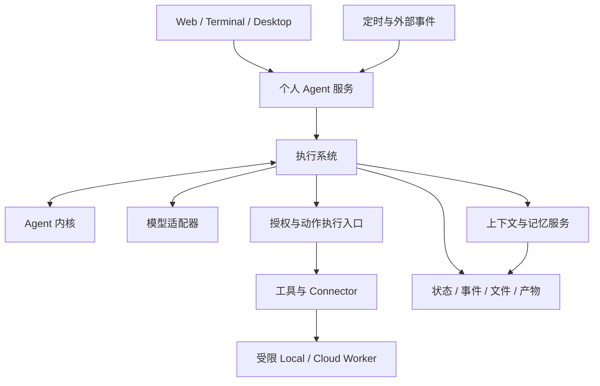

# Agent 系统基线设计与验收矩阵

> 状态：目标设计，待实施与验收；不是当前能力声明。
> 日期：2026-10-26
> 路线：Agent 系统基线 B0–B3 → 个人 Agent 产品 P1–P3 → 云端执行 C1。
> 关联：[Kevin 产品规划](kevin-product-architecture-plan.md)、[实施路线](kevin-implementation-roadmap.md)、[TS 迁移记录](typescript-migration-plan.md)。

## 1. 决策与适用范围

先补齐可复用、可恢复、可控制的智能体系统基线，再确定基于它的个人智能体产品形态。Kevin 是基线上的个人产品，不应把品牌、页面或通知偏好写入内核。

基线覆盖运行内核、执行系统、上下文、记忆接口、工具与权限、持久化、产物、观测及验收。完整目标先定义，按依赖逐步交付；阶段划分不缩减最终能力。

从 B0 起使用代码任务、研究报告、周期监测三个场景贯穿验证。Goal、Plan、Routine 契约同时确定，薄的应用入口随基础能力一起验证，最终页面与产品默认行为在 P 阶段收敛。

单智能体表示一个用户面对持续的身份与工作入口；内部允许多个独立 Task 并行。任务之间不自动共享权限、账户、完整上下文或预算。多 Agent 团队编排不是本路线的前置条件。

### 1.1 文档权威与变更

- 本文件规定系统分层、生命周期、不变量、基线完成定义和验收矩阵。
- 实施路线规定 B/P/C 阶段的任务与进入条件；产品规划描述个人产品目标。
- 现有产品规划中的 SQL、API 和配置示例是设计输入，B0 必须按本文件形成版本化契约与 ADR 后才实施。
- 技术选择、支持范围或完成定义变更需记录原因和受影响的验收项，不能通过修改状态文字宣布完成。

## 2. 当前代码边界

当前主分支已切换到 TS/Bun 主运行链。源码清理、行为对齐、本地测试与外部验收分别记录，不能由删除 Python 推导出所有旧能力等价。

| 当前输入 | 可复用内容 | 需要补齐的边界 |
|---|---|---|
| [AgentRuntime](../packages/core/src/runtime/agentRuntime.ts) | 运行循环与审批恢复入口 | 显式运行决策、等待/停止语义、依赖隔离 |
| [RuntimeOptions](../packages/core/src/runtime/runtimeOptions.ts) | 模型与工具运行配置 | 从具体 JsonStateStore 转为 ports；执行信号贯穿工具 |
| [TaskService](../packages/core/src/tasks/taskService.ts) | Task/Run 关联 | 当前 cancel 只更新状态；需真实取消、排队和恢复 |
| [PlanningState](../packages/core/src/types/planningTypes.ts) | Run 内计划与 todo | 长期 Plan 跨 Run、版本化，不能直接复用当前生命周期 |
| [WorkflowPlan](../packages/core/src/workflow/workflowModels.ts) | 工作流节点与边 | 实例化到统一 Task/Run，不另建恢复机制 |
| [HostServices](../packages/host/src/services/hostServices.ts) | 服务组装入口 | HTTP 与 Terminal 统一连接状态所有者，避免重复调度 |
| [工具注册](../packages/core/src/tools/toolRegistry.ts) | 文件、Git、Web、MCP 等工具 | 参数、权限、副作用分类、取消与预算的统一执行契约 |
| [Memory](../packages/core/src/memory/memoryTools.ts) | 记忆操作入口 | Markdown 事实源、来源确认、冲突与索引修复 |

以上是静态核对结果，不代表本次已通过运行测试。B0 为旧能力逐项记录：复用、补齐、替代、有意淘汰或外部待验收；淘汰必须写明理由和兼容影响。

## 3. 系统分层与所有权

| 模块 | 责任 | 不得承担的责任 |
|---|---|---|
| core | 消息/附件、运行状态、上下文组织、动作与结果契约、抽象 ports | SQL、宿主进程启动、HTTP 页面逻辑、品牌策略 |
| execution | Run 协调、调度、lease、Action Ledger、checkpoint、输入队列、预算、授权强制执行 | 用户人格、页面状态机、自行扩大工作范围 |
| personal | 身份、Project、Goal、长期 Plan、Routine、工作延续和通知策略 | 绕过执行入口调用工具、复制恢复机制 |
| providers | 模型协议、能力探测、流式/结构化结果适配 | 自行调度 Task 或授予权限 |
| connectors / executors | 外部能力适配、进程/网络/文件隔离、设备执行 | 隐式继承全部宿主凭据或跨任务授权 |
| storage | SQLite、migration、Markdown、文件与产物存储、快照 | Agent 决策或个人任务优先级 |
| host / apps | 服务生命周期、认证、API/事件投影、依赖组装 / 用户交互 | 在不同客户端各自维护调度与业务状态 |

目标目录为 `packages/core`、`execution`、`personal`、`providers`、`connectors`、`executors`、`storage`、`host` 和 `apps/*`。接口由使用方定义，适配器实现接口；core 不反向导入具体适配器。可先按职责建立模块再拆包，避免一次性搬目录。

内核接收显式状态与输入，产生调用模型、请求动作、等待输入/审批或结束等决策。执行系统处理 I/O、持久化和副作用，再把结果送回内核。内核逻辑可用固定输入、假模型和假工具独立测试。

本地生产 profile 使用一个常驻服务作为调度和状态变更所有者，客户端连接同一服务；嵌入式 SDK 测试 profile 必须使用隔离状态目录，不得与常驻服务竞争同一数据目录。云端采用独立的协调与租约机制，不将本地单进程锁当作分布式保证。

## 4. 领域对象和生命周期

| 对象 | 定义与所有者 |
|---|---|
| Agent Profile | personal 管理持续身份、偏好和默认设置，不代表某个模型或进程 |
| Project | personal 管理相关工作、资料及资源范围 |
| Conversation | 沟通记录，可关联多个工作；不作为执行状态唯一事实源 |
| Goal | personal 管理长期结果、完成标准及延续授权 |
| Plan | personal 管理跨 Run 的版本化工作安排；内核只消费当前相关部分 |
| Task | execution 管理有边界的工作、交付标准、资源和预算；可关联 Goal/Plan |
| Run | Task 的一次可恢复逻辑执行；恢复保持 ID，新执行轮次创建新 ID |
| Action | 一次具体操作，保存 operation ID、规范化参数、账户、授权和结果 |
| Routine | personal 管理周期/事件规则与通知策略；调度通过 execution 完成 |
| Artifact | 产物内容、版本、哈希、生成 Action/Run 和验收证据 |

简单问答不强制创建 Project/Goal/Plan；仍通过可审计的 Run 执行。Workflow 是版本化模板，实例化为同一套 Task/Run；不建立另一套调度、权限或恢复通道。

### 4.1 必须锁定的不变量

1. 单 Task 同时最多一个有效 active Run；独立 Task 可并发，共享资源写入需锁或隔离工作区。
2. 自动进程恢复保持 Run ID、递增执行租约 epoch；显式重试创建新 Run，已经发生的 Action 不因新 Run 自动重放。
3. Goal/Plan 的修改保留版本；扩大范围必须重新裁决授权。模型结束本轮不自动证明 Task/Goal 完成。
4. Task 完成携带产物/测试/来源或用户验收证据；缺少条件时标记待输入、阻塞或失败。
5. 输入、审批、取消、预算和恢复状态都是持久事实，不能只存在于 UI 或内存。

Run 的标准状态为 `queued / preparing / running / waiting_input / waiting_approval / paused / reconciling / completed / failed / cancelled / expired`。Action 的状态为 `prepared / dispatched / succeeded / failed / unknown / cancelled`。Action 为 unknown 时 Run 进入 reconciling；不得仅因租约到期就把该动作当成未执行。B0 定义合法转换表、终态和每种状态的可用控制操作。

## 5. 执行、恢复与用户介入

执行链路：持久 Inbox → 去重/准入 → Task/Run → 获取 lease → 构建上下文 → 模型决策 → 动作授权 → 写入 intent → dispatch → 持久化结果/状态/checkpoint/outbox → 客户端投影。

- API 幂等记录包含 scope、key、请求摘要和处理中/完成状态；同 key 不同请求内容返回冲突，并发同 key 只接受一次。
- Run 状态转换使用版本检查；lease epoch 同时约束结果提交和新动作 dispatch，不能仅锁住一个数据库行而让旧 Worker 继续执行。
- 外部调用不处于数据库事务内；确定结果后的相关状态、checkpoint 和待投递事件在明确的事务内提交。outbox 消费可重试，事件按 ID 去重。
- 每个动作在执行前记录稳定 operation ID；支持幂等的提供方复用该 ID。不支持幂等但可查询回执的动作先核对；无法确认的动作保持 unknown，由用户带证据处理。
- 不承诺外部副作用 exactly-once。fencing 和撤销不能撤回已经送达外部系统的请求。
- checkpoint 包含消息/输入消费游标、上下文摘要、计划版本、Action 状态、待输入/审批、产物引用和预算引用；恢复所需数据必须受到保留保护。
- 追加指令按明确 Task/Run 目标持久排队，在安全边界消费并展示已接收/已应用；不能悄悄覆盖原目标。取消等控制信号可打断执行，不必等待下一个普通输入消费点。
- pause 停止新动作，按执行器能力收敛当前动作；cancel 先持久化 cancel_requested 控制事件、阻止新动作，再传播到运行、工具和子进程树。存在 unknown Action 时 Run 保持 reconciling，核对和收敛完成后才确定终态，不能提前记录 run.cancelled。
- 长时间等待审批/输入不持有活跃执行租约；唤醒时重新竞争租约并复核授权、版本和预算。

## 6. 权限、隔离和成本

归属链为 `Task → Project/资源范围 → Grant → Connector 账户 → Action`。Grant 明确允许动作、资源、有效期、触发方式和预算；Goal 存在不等于无限延续授权。派生 Task 的授权不得超出父级范围。

每次实际 dispatch 前检查当前授权版本、有效期、撤销状态、资源、账户和预算。审批绑定 Action ID、规范化参数摘要、工具版本和资源；实质变化重新裁决。Task A 的审批不能因同一 Agent 身份被 Task B 隐式复用。

Policy 决策与实际执行分别测试。网页、文件、MCP 和 Memory 内容不能改变系统权限。统一入口覆盖内部工具、Connector、Workflow 和未来辅助执行者，不能留下直调工具绕过通道。工具契约声明 replay safety（只读、幂等、可查询回执、不可重复），调度重复投递不意味着所有工具均可自动重试。

本机执行必须验证文件、网络、环境变量和进程树边界；cwd 与命令 allowlist 不是完整隔离。B0 对 macOS/Linux 选择可验证的执行后端并记录 ADR；无可用隔离后端时受限执行失败关闭。浏览器登录态与下载隔离，设备 Bridge 显式配对和撤销。

凭据在 SQLite 中只保存加密密文和元数据，主密钥优先系统 Keychain，受控环境变量是明确标识的降级方案。模型适配器和受信任 Connector 按需使用凭据，工具进程不继承宿主完整环境，密钥不注入模型上下文。

预算覆盖 Run、Task 和用户全局并发额度；调用前预留、完成后结算，恢复/重试不能清零。费用估算与实际用量区分；未知定价时不承诺严格美元限额，仍执行 Token、时间、次数上限。

## 7. 上下文、记忆、产物与数据生命周期

| 数据 | 事实源 | 关键规则 |
|---|---|---|
| 当前上下文 | 受预算约束的输入与选中资源 | 按来源/范围选择；压缩不能丢失未完成动作和用户约束 |
| 工作状态 | SQLite 结构化实体与操作记录 | 恢复不依赖模型从自然语言摘要猜测状态 |
| 长期记忆 | Markdown | SQLite 只索引路径、哈希、来源、确认状态和版本；不引入向量服务 |
| 外部知识 | 文件/Web/Connector 的引用与必要快照 | 记录来源、时间和可用性，作为不可信输入 |
| 产物 | 文件内容与 metadata | 可读取真实内容，校验哈希，关联生成过程与版本 |

候选记忆与用户确认事实分开。确认绑定内容版本，Agent 修改正文不能静默继承旧版本的确认。跨 Project 读取、共享记忆写入受资源策略约束。

Markdown 写入使用内容版本校验和原子替换，明确编辑冲突；文件成功但索引失败时可通过重建修复。数据库与文件不声称共享单一 ACID 事务，需要可检测、可修复的一致性协议。

区分“记忆导入”和“完整状态恢复”。完整备份有 manifest，覆盖一致的 SQLite 快照、Markdown、产物、配置版本与恢复说明；默认导出排除凭据，跨机器恢复需要明确的重新授权流程。恢复到新目录验证真实内容，不能只验 metadata。

恢复旧快照后先冻结自动调度、作废旧 lease，并复核授权及可能已发生的外部操作；不能凭旧 checkpoint 自动重放发送/发布动作。记录恢复批次及人工核对证据。

保留策略保护未完成任务引用的恢复数据；已清理事件的 SSE 游标返回明确的重新同步指令和实体快照。删除覆盖数据库、文件、索引及后续备份保留规则，删除审计不重新保存敏感正文。

## 8. 事件、主动性与本地服务

事件统一包含 `event_id`、`schema_version`、`occurred_at`、`type`、`actor`、实体引用与 payload。Run 内 sequence 有序，跨 Run 不假设全局顺序。消费者去重、分页和重连，持久实体与可重建投影的关系必须明确。

记录动作、决策摘要、来源、错误、时间和成本，不要求保存模型隐含推理；日志与诊断包默认脱敏并限制原始输入输出保留。

三类唤醒共用执行系统：即时消息、前置完成/用户补充等工作延续、定时/外部事件。Routine 先规则过滤、去重、冷却，再进行必要的有界模型判断。无进展则等待相关事件，不无限循环调用模型。

personal 决定安静时间、紧急程度、通知合并与“何时值得通知”；execution 执行已经授权的触发规则。通知默认面向用户自己的客户端，外部发送使用独立授权。

常驻服务具备 start/stop/status、单实例所有权、崩溃恢复和可选开机启动。对每个 Routine 配置漏跑策略（跳过/合并补一次/有界补跑）及重叠策略（跳过/排队/合并），明确时区和 DST；恢复不能无界补发历史任务。

本地休眠/关机期间不执行任务。Cloud Worker 后续使用独立服务身份、隔离、队列、对象存储和密钥管理；本地设备能力仍依赖在线且获授权的 Bridge。不能用更换数据库适配器代表完成云化。

## 9. 基线验收矩阵

除明确暂缓项外，所有状态初始为“待验收”。存在代码表示候选复用，不表示该行通过。每项证据记录：commit、环境、依赖版本、命令/脚本、结果、产物及未通过项。

| ID | 当前输入/缺口 | 目标与负责模块 | 必需验收证据 | 关口 |
|---|---|---|---|---|
| K01 | TS 主链已有，旧能力等价未全量核对 | core/host：逐能力映射与版本化 contracts | 映射表无未说明项；现有测试回归报告 | B0 |
| K02 | 模型适配与运行循环已有 | core/providers：文本、图片/附件引用、工具及流式能力边界 | 已声明协议 contract tests；不支持能力显式报错 | B1 |
| K03 | 上下文功能需逐项审计 | core/context：选择、摘要、压缩与预算 | 长对话下保留用户约束、pending action，且不越 scope | B1→B3 |
| K04 | 工具注册已有，执行边界待统一 | execution/connectors：schema、输出限制、生命周期 | 非法参数、超大输出、超时和取消均有测试 | B1 |
| K05 | 现有审批不是目标完整授权契约 | execution/policy：账户/参数/资源/版本绑定 | 跨任务复用、过期、撤销、参数变更和不可信内容诱导均不能越权 | B1→B2 |
| K06 | LocalExecutor 宿主执行；原生沙箱按用户决定暂缓 | ports/execution：预留平台后端、策略和能力探测 | 当前验证隔离请求失败关闭；真实文件/网络/环境隔离在独立阶段验收 | 暂缓，不阻塞其余基线 |
| K07 | JSON 状态存储 | storage：SQLite、迁移、接口、JSON importer | 同步短事务、WAL、外键、并发、锁定/只读/磁盘不足、迁移失败 | B2 |
| K08 | TaskService 单进程 | execution：持久队列、lease/epoch、单 active Run | 并发领取、旧 Worker 恢复、重复 request 不重复执行 | B2 |
| K09 | 缺完整副作用恢复协议 | execution：Action Ledger、checkpoint、outbox | 工具成功未落盘时崩溃；回执核对或 unknown，不盲目重放 | B2 |
| K10 | cancel 只更新 Task 状态 | execution/executors：暂停/取消/输入队列 | 长工具中介入、取消后进程树收敛，输入消费可追踪 | B2 |
| K11 | 等待与预算需持久化 | execution：等待释放 lease、持久预算 | 重启/重试不重置预算；多 Task 全局额度不超发 | B2 |
| K12 | 现有 schedule 记录与手动入口 | execution/personal：触发和服务生命周期 | 关闭客户端、服务重启、休眠、DST、漏跑与重叠策略 | B2 |
| K13 | 当前 Memory 为 store 内容 | core/personal/storage：Markdown 与索引 | 编辑冲突、确认失效、索引重建、范围删除和受限检索 | B3 |
| K14 | 产物目标未贯通 | execution/storage：内容、哈希和来源 | 报告/补丁可打开，来源可查，路径越界被拒绝 | B3 |
| K15 | Web/Terminal 独立服务入口 | host/apps：认证与监听边界、统一服务、版本化事件 | 各部署 profile 的监听、认证、Origin/CORS、未授权写入失败；两客户端一致，断线/重复事件/过期游标重同步 | B0→B3 |
| K16 | 完整恢复未验收 | storage/execution：快照/迁移/冻结调度 | 新目录完整恢复正文与文件；旧快照不自动重放外部动作 | B3 |
| K17 | 已有 Goal/Plan/Routine 设计输入 | personal 薄应用：目标与执行契约 | 三场景贯通；Goal 完成有证据，计划变更保留授权边界 | B0→B3 |
| K18 | 本地测试不能替代真实服务 | providers/connectors/host：环境验收 | 真实 Provider/MCP 成功与错误路径、诊断脱敏、部署启动证据 | B3 |

### 9.1 有限且完整的验收范围

B0 冻结能力—场景—环境矩阵，列明当前工具的处置、支持的模型协议、执行平台与部署 profile。建议首份环境矩阵覆盖 macOS arm64 与 Linux x64；其余发行架构在 P3 分别验收，不能由交叉编译推导可用。最终支持清单由 spike 证据锁定，变更必须公开记录。

三类场景覆盖：代码任务的读改测与审批；研究报告的检索、来源、多模态附件和产物；周期监测的服务常驻、触发补偿和有意义通知。它们是组合验收用例，不限制未来产品只能完成这三类工作。

B3 通过要求 K01–K18 中除独立暂缓的 K06 外，在冻结范围内具备证据，所有阻塞缺口关闭，受限功能明确标识。缺少真实 Provider 或恢复证据时，记录待验收，不以 fake 测试代替。K06 按用户决定独立暂缓；当前交付限定为无安全隔离的本地执行，不宣称完整沙箱基线通过。基线不包含企业 RBAC/计费、Agent 市场、多 Agent 团队产品、完整云端服务和最终 UI；这些不应成为无限前置工作。

## 10. 交付关口与首批任务

| 阶段 | 交付 | 进入下一阶段的条件 |
|---|---|---|
| B0 | 能力映射、契约、状态转换、目录责任、支持矩阵、SQLite spike 与隔离接口 | 关键方案有 ADR，所有缺口与测试有归属 |
| B1 | 有界 Run、模型/工具、权限与执行生命周期；现有 UI/测试入口验证 | 单次执行正确，权限失败关闭，工具取消能力逐项声明和验证；K06 独立暂缓 |
| B2 | 持久 Task/Run、Action Ledger、恢复、预算、常驻服务与调度 | 故障窗口、重复触发、旧 Worker 和实际取消验证通过 |
| B3 | 记忆/产物/多端一致性、完整恢复、三场景与外部证据 | 冻结范围内 K01–K18 全部验收 |
| P1 | 身份、目标/计划、例行工作、通知策略与产品定义 | 个人工作契约及权限/预算边界通过 |
| P2 | 产品交互、记忆/连接管理和设备授权 | 用户可仅通过界面完成交办、介入、验收和恢复 |
| P3 | CLI、命名/配置迁移、自托管与完整分发 | Kevin 完成定义与各发行环境证据通过 |
| C1 | Cloud Worker、Control Plane、Bridge 的独立信任与可靠性 | 云端场景单独验收 |

关口按依赖组织，相关契约和验证入口可以提前开发，不能拖到产品阶段才首次测试长期工作。旧周数不作为当前排期；B0 后按模块、证据工作量和人员重新估算。

首批工作：

1. 建立 K01–K18 的能力映射和证据登记，复核现有测试与文档漂移。
2. 固化 Run/Action/Task、Event、Grant、工具和输入队列契约；明确 Goal/Plan/Routine 对接接口。
3. 修正 Host 本地监听、认证/CORS 和有限循环等安全默认值，增加针对性回归。
4. 验证 SQLite 驱动和常驻服务所有权，预留目标平台执行隔离接口，记录 ADR。
5. 定义使用方 ports，以现有 JSON adapter 先解耦 core，再实现 SQLite adapter 与导入；避免只搬文件而保留反向依赖。
6. 建立三类场景的薄验证入口和故障注入点，随后逐关口推进。

当前不因本次文档调整重命名所有包、删除旧能力、重做页面或宣称基线已经完成。

## 实施记录

- [B0 首批实现与证据](baseline/b0-evidence.md)：安全默认值、存储端口、版本化执行契约及 SQLite/macOS 隔离试验。B0 尚有未关闭项，详见逐能力映射。

## 2026-10-26 范围调整：沙箱暂缓

用户明确决定暂缓沙箱后端上线，保留 Windows MXC、macOS 原生、Linux 原生和可选容器适配点。Docker 不作为个人本地执行的前置依赖。当前 LocalExecutor 是宿主执行，提供输出界限、超时与 POSIX 进程组回收；不保护宿主文件、网络和凭据，也不能约束逃离进程组的进程。请求 isolated 策略一律失败关闭，直到真实后端及相关工具路由完成验收。其他 B1/B2/B3 工作继续，不以本次延期暗示 K06 已完成。

- [执行器预留与当前边界 ADR](baseline/adr-001-local-execution.md)
- [第二批工具与生命周期证据](baseline/b1-execution-evidence.md)
