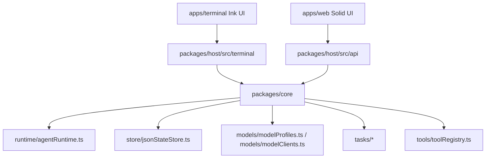

# Architecture

Agents is now a TypeScript workspace.

## Boundaries

- `apps/terminal`: Ink UI, terminal protocol client, layout, transcript rendering, and smoke scripts.
- `apps/web`: Solid UI and Vite build.
- `packages/host`: Bun host process adapters, HTTP routes, static web serving, shared service wiring, and terminal host transport.
- `packages/core`: Shared runtime/domain code used by HTTP and terminal host adapters.
- `config`: Non-secret defaults and local override shape.
- `deploy`: Container and compose entrypoints.

## Layering Rules

- UI entrypoints belong in `apps/*`.
- Backend hosts and shared runtime/domain behavior belong in `packages/*`.
- Entrypoints should only parse inputs, compose services, and delegate.
- A module name must describe its concrete responsibility.
- Avoid broad buckets such as `utils.ts` unless the file is tiny and genuinely generic.

## Request Flow

1. Web calls `packages/host/src/api/agentRoutes.ts`.
2. Terminal sends NDJSON to `packages/host/src/terminal/main.ts`.
3. HTTP host and terminal host create shared services through `packages/host/src/services/hostServices.ts`.
4. Shared services load settings and model profiles from `packages/core`.
5. Runtime emits protocol-neutral events.
6. Store records run/task state in the configured JSON state file.
7. HTTP and terminal layers project those events into their own response formats.

## Extending The System

- New HTTP API: add a focused route module under `packages/host/src/api/`.
- New terminal command: keep parsing in `packages/host/src/terminal/main.ts` thin and move command data or behavior to a specific terminal host module.
- New runtime capability: add it under the matching `packages/core/src/<domain>/` directory with a concrete file name.
- New UI state: keep terminal and web state local to their app unless it is shared runtime data.
