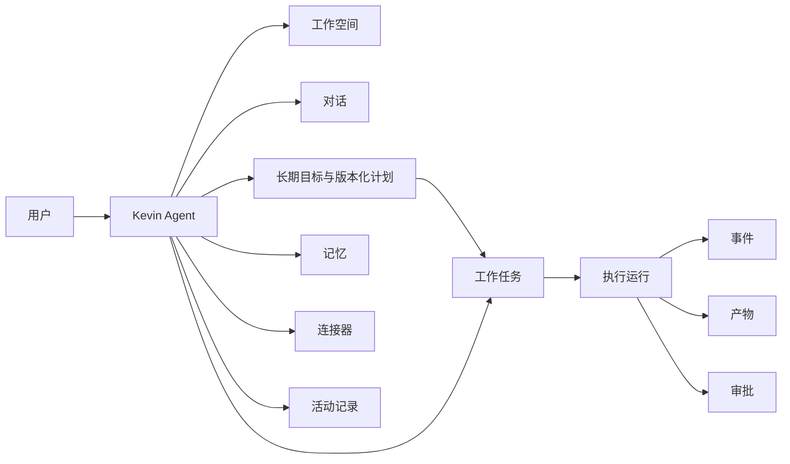

# Kevin：个人长期运行 Agent 产品规划

> 状态：个人产品目标；系统基线先行
> 修订日期：2026-10-26
> 目标：把当前 `Agents` 仓库收敛为一个可长期运行、可审查、可配置、可分发的单 Agent 产品，产品名为 **Kevin**。
> 范围：本方案覆盖产品定位、能力边界、系统架构、配置、数据库、界面、仓库治理、分发方式、迁移路线和验收标准。

> 复核说明：[Agent 系统基线设计与验收矩阵](agent-system-baseline.md) 规定系统分层、执行契约和基线完成定义；[实施路线](kevin-implementation-roadmap.md) 规定 B0–B3、P1–P3、C1 顺序。本文件保留完整个人产品目标，页面/配置/SQL 示例为产品设计输入。当前仓库尚未完成这些目标能力。

## 1. 结论先行

先构建完整、可复用的 Agent 系统基线，再在基线上形成 Kevin 个人产品。Kevin 应具有持续身份、记忆、工作空间、后台工作、权限边界和活动记录；品牌与页面策略属于个人服务和客户端，不进入运行内核。

用户面对的核心对象只有一个：**Kevin**。用户可以和 Kevin 对话，给 Kevin 一个长期目标，连接必要的应用和本地电脑，查看它正在做什么，在关键动作前批准它，并随时暂停、修改或恢复工作。

当前仓库已经拥有可复用的基础：TypeScript runtime、多模型 profile、工具注册、权限与审批、Run/Task/Session 状态、MCP、Terminal、Web UI 和 SDK 协议。下一步先完成基线契约、行为对齐与可靠性验收，再收敛产品交互。当前 Task 仍由单进程 service 驱动，状态仍以 JSON store 为主，不能把它们描述成已经具备 Durable Execution 或云端常驻能力。

建议的产品形态：

- 默认是一个 Kevin 实例，一个用户一个 Agent 身份。
- 对话、任务、记忆、连接器、工作空间和活动全部围绕 Kevin 组织。
- 支持前台即时任务和后台持续任务，但后台任务必须可见、可暂停、可恢复。
- 高风险动作默认需要批准；低风险动作可以自动执行。
- 本地优先运行，数据库和远程执行能力采用可替换适配器，避免一开始被云基础设施绑死。
- 本地个人产品聚焦个人效率和开发工作，不承诺企业多租户、多 Agent 编排和全自动无人值守。

## 2. 对 Dot 的研究与可借鉴之处

公开资料把 Dot 描述为一个 always-on agent：它拥有自己的工作空间和浏览器，可以持续推进项目；用户可以在桌面、Web、移动端查看任务进度、结果和输入请求，也可以连接电脑和外部应用。官方资料还强调了连接应用的权限边界、活动查看和需要用户批准的动作。

参考资料：

- [OpenAI：Introducing dots](https://openai.com/index/introducing-dots/)
- [ChatGPT Learn：Meet dots](https://learn.chatgpt.com/docs/dots)
- [ChatGPT Learn：Connect computers and apps](https://learn.chatgpt.com/docs/dots/computers-and-apps)
- [OpenAI Help：Getting started with your dot](https://help.openai.com/en/articles/20001530-getting-started-with-your-dot)

Kevin 应借鉴这些产品原则，而不是复制其云基础设施：

| Dot 的产品原则 | Kevin 的落地方式 |
|---|---|
| Agent 有持续身份 | `agent_profile` 保存名称、头像、人格、目标和行为规则 |
| Agent 有自己的工作空间 | 每个 Kevin 实例有独立 workspace、文件索引和运行目录 |
| 工作可以在后台继续 | `task`、`run`、调度器和恢复状态组成长期任务系统 |
| 用户可以随时介入 | 活动流、审批卡片、暂停、继续、追加指令 |
| 连接应用但权限受控 | Connector + capability + scope + approval policy |
| 多端查看同一个工作 | Web 是主界面，Terminal 是开发和故障排查入口 |
| 工作结果可审查 | Event、Artifact、Decision、Approval、Cost 形成可查询活动记录 |

Kevin 不应直接承诺“永远在线”或“完全自主”。本地版本应把它定义为：**可持续运行、可观察、可暂停、可恢复的个人 Agent**。

## 3. 产品定位与非目标

### 3.1 目标用户

第一目标用户是需要持续推进代码、资料、文档和个人工作的人。典型任务包括：

- 在一个代码仓库中持续修复问题、运行测试并提交变更。
- 收集资料，整理成报告、计划或文档。
- 定时检查项目状态，发现变化后生成摘要或提醒。
- 在本地文件、Git、Web 和已连接服务之间完成有限范围的工作流。
- 维护一个长期项目上下文，而不是每次从零开始对话。

### 3.2 非目标

本地个人版本明确不做：

- 多 Agent 群聊、复杂团队编排和 Agent 市场。
- 企业级多租户计费、组织层级和复杂 RBAC。
- 默认可发送邮件、发布内容、付款或修改生产系统。
- 把所有工具都包装成“自动执行”；高风险动作必须走策略和审批。
- 追求与 OpenAI、Claude 或 Codex 的全部功能对等。

## 4. 产品对象模型

用户在界面上应该理解以下对象：



- **Agent**：唯一的 Kevin 身份、行为和全局配置。
- **Workspace**：Kevin 可以读取和修改的文件、仓库、运行目录和索引。
- **Conversation**：用户与 Kevin 的交流上下文。
- **Goal / Plan**：可选的长期结果与版本化工作安排，跨会话和 Run 存续。
- **Task**：有边界的工作单元，包含交付标准、资源与预算，可以被启动、暂停、恢复和取消。
- **Routine**：已授权的周期或事件触发工作，通过同一执行系统调度。
- **Run**：Task 的一次可恢复逻辑执行；进程恢复保留 ID，新执行轮次创建新 ID。
- **Event**：模型、工具、审批、状态和错误事件。
- **Artifact**：报告、补丁、文件、截图、链接等结果。
- **Memory**：用户明确保存或系统确认过的长期信息。
- **Connector**：外部应用或本地设备连接，包含权限范围。
- **Approval**：需要用户确认的具体动作，而不是模糊的“允许 Agent”。

## 5. 建议的整体架构

采用“客户端 → 个人 Agent 服务 → Agent 系统基线 → 基础设施适配器”的分层。完整结构、模块所有权和目录以 [基线第 3 节](agent-system-baseline.md#3-系统分层与所有权) 为准。

- 内核负责运行语义、上下文和动作决策，不直接操作数据库或启动宿主进程。
- execution 负责持久工作、调度、权限强制执行、恢复和预算。
- personal 负责身份、Project、Goal、Plan、Routine、工作延续和通知策略。
- providers、connectors、executors、storage 实现具体环境能力。
- host 组装服务并提供 API/事件；Web、Terminal 和未来 Desktop 连接同一状态与调度所有者。

单 Agent 不限制只能运行一个任务；并行 Task 的数据范围、账户、审批和预算独立，写同一资源时协调冲突。

现有 team/agent.run 能力先在 B0 能力矩阵中登记用途和兼容影响。P1 决定默认隐藏、保留为实验能力或迁出扩展，不能在基线阶段仅为单 Agent 品牌删掉未审计的能力。

## 6. Runtime 设计

### 6.1 Run 生命周期

标准状态为 `queued / preparing / running / waiting_input / waiting_approval / paused / reconciling / completed / failed / cancelled / expired`；它们是状态集合，不是必须依次经过的流水线。合法转换、Action 状态及恢复规则见 [基线第 4–5 节](agent-system-baseline.md#4-领域对象和生命周期)。

自动恢复保持 Run ID、更新 lease epoch；明确的新执行轮次创建新 Run。结果不确定的 Action 为 unknown，Run 进入 reconciling，不自动重放副作用。状态转换、输入、审批和预算持久化；长时间等待释放执行租约。

### 6.2 工作模式

- **Chat mode**：短交互、低延迟，适合问答和即时修改。
- **Task mode**：有目标、有步骤、有产物，适合持续工作。
- **Scheduled mode**：按时间或事件触发，必须显示下次执行时间和权限范围。
- **Review mode**：只读分析和规划，不执行写入动作。

### 6.3 Agent 循环

1. 读取用户消息、Task 目标和 workspace 状态。
2. 生成执行计划或直接进入单步处理。
3. 根据 Policy Engine 判断工具是否可用、是否需要批准。
4. 在实际执行前复核授权并持久化 Action intent，再执行工具。
5. 按事务边界保存结果、状态、checkpoint、事件及产物引用；不确定结果先核对。
6. 判断继续、等待输入、等待审批或结束。
7. 向 Web、Terminal 和 SDK 投影同一套事件。

### 6.4 长任务必须具备的能力

- 幂等 `request_id` 和工具调用 ID。
- 进程重启后恢复 queued/running/paused 状态。
- 单次运行的最大时间、最大 token、最大成本和最大工具次数。
- 失败重试策略，区分可重试错误和业务错误。
- 任务取消传播到当前工具和子进程。
- 每个工具调用的输入摘要、输出摘要、耗时和错误。
- 用户追加指令后保留原始任务目标和决策记录。

## 7. 配置设计

配置分为四层，优先级从高到低：命令行参数 > 环境变量 > 用户配置 > 默认配置。

### 7.1 推荐配置文件

用户配置目录：

```text
~/.kevin/
  config.toml
  kevin.db                # 数据库保存加密后的凭据密文，不保存明文密钥
  workspaces/
  artifacts/
  logs/
  memory/
```

项目配置：

```text
.kevin/
  project.toml
  instructions.md
  policy.toml
  connectors.toml
```

### 7.2 `config.toml` 示例

```toml
[kevin]
name = "Kevin"
locale = "zh-CN"
timezone = "America/New_York"
profile = "developer"

[server]
host = "127.0.0.1"
port = 8020
public_url = "http://localhost:8020"

[storage]
driver = "sqlite"
database_url = "~/.kevin/kevin.db"
artifact_root = "~/.kevin/artifacts"
workspace_root = "~/.kevin/workspaces"

[models.default]
provider = "openai"
model = "gpt-5"
base_url = "https://api.openai.com/v1"

[models.fast]
provider = "openai"
model = "gpt-5-mini"

[agent]
system_prompt_file = "~/.kevin/instructions.md"
max_context_tokens = 128000
max_tool_iterations = 40
max_run_minutes = 30
max_cost_usd = 2.0

[policy]
default_mode = "ask-on-write"
allow_network = false
allow_shell = false
allow_background_tasks = true

[workspace]
read_paths = ["~/Projects"]
write_paths = ["~/Projects/active"]
exclude = ["**/.env", "**/node_modules", "**/.git/objects"]

[notifications]
enabled = true
channels = ["web", "terminal"]

[connectors]
enabled = ["filesystem", "git", "web"]
```

### 7.3 配置原则

- Secret 不写入 TOML，不打印到日志，不随诊断包导出。
- 每个配置项必须有类型、默认值、来源和脱敏显示方式。
- Provider 配置与 Agent 行为配置分离。
- 工具权限不能只由 `enabled_tools` 字符串表达，必须升级为结构化 Policy。
- 运行时配置变更要有审计事件，并明确是否影响当前 Run。

## 8. 数据库设计

### 8.1 为什么从 JSON 迁移到 SQLite

当前 JSON state store 适合单进程开发，但 Kevin 的核心体验要求任务恢复、活动查询、审批列表、分页、并发写入和全文搜索。SQLite 是本地优先产品的合理第一步；通过 `Store` 接口保留 Postgres 适配器，未来再支持远程部署。

### 8.2 核心表

```text
agents
  id, name, slug, avatar, system_prompt, timezone, created_at, updated_at

workspaces
  id, agent_id, name, root_path, status, policy_json, created_at, updated_at

conversations
  id, agent_id, workspace_id, title, status, created_at, updated_at

messages
  id, conversation_id, role, content_json, sequence, created_at

tasks
  id, agent_id, workspace_id, conversation_id, title, goal, status,
  schedule_json, priority, next_run_at, created_at, updated_at

runs
  id, task_id, conversation_id, status, worker_attempts, request_id,
  model_profile, started_at, finished_at, error_code, checkpoint_json

events
  event_id, schema_version, run_id, task_id, sequence, type, actor, payload_json, occurred_at

approvals
  id, run_id, tool_call_id, action_summary, risk, status,
  requested_at, decided_at, decided_by, decision_reason

tool_calls
  id, run_id, event_id, name, arguments_json, result_json,
  status, risk, started_at, finished_at

memories
  id, agent_id, workspace_id, kind, path, content_hash, source,
  confidence, user_confirmed, created_at, updated_at, expires_at

connectors
  id, agent_id, type, name, status, config_json, secret_ref, created_at, updated_at

connector_permissions
  id, connector_id, capability, resource_scope, mode, expires_at

artifacts
  id, run_id, workspace_id, type, name, path, mime_type, sha256, metadata_json, created_at

schedules
  id, task_id, expression, timezone, enabled, next_run_at, last_run_at

usage_records
  id, run_id, provider, model, input_tokens, output_tokens, cost_usd, created_at

settings_audit
  id, actor, key, old_value_redacted, new_value_redacted, created_at
```

### 8.3 索引与保留策略

- `events(run_id, sequence)`：按运行重放。
- `tasks(agent_id, status, next_run_at)`：调度器取任务。
- `approvals(status, requested_at)`：审批中心查询。
- `messages(conversation_id, sequence)`：消息分页。
- `memories(agent_id, workspace_id, kind)`：上下文注入。
- `artifacts(run_id, created_at)`：结果列表。
- Memory 的事实源是可读、可编辑、可导出的 Markdown 文件；SQLite 只保存路径、哈希、类型、来源、确认状态和更新时间，不引入向量数据库或 embedding。
- 对消息和事件做可配置保留；原始事件可归档到 JSONL 或对象存储。
- 大文件不进入数据库，只保存路径、哈希、MIME 和元数据。

### 8.4 迁移策略

1. 定义 `Store` 接口，先写 SQLite adapter。
2. 为 JSON store 增加只读导入器。
3. 首次迁移先备份旧数据，显示导入清单，再执行 JSON → SQLite；失败保留原始数据与诊断。
4. 通过 migration table 管理 schema 版本。
5. 默认停止新功能继续依赖 JSON store。
6. 增加 `kevin doctor storage` 检查数据库、迁移和文件权限。

## 9. 工具与连接器策略

工具不再按“能不能做”分类，而按风险和产品价值分类：

### Tier 0：默认开启

- 读取文件、列目录、搜索文本。
- 读取 Git 状态、diff、日志。
- 读取当前 Session、Task 和 Activity。
- 生成摘要、计划和报告。

### Tier 1：首次确认后可记住

- 写文件、应用 Patch、创建分支。
- 运行测试、启动受限开发命令。
- 读取指定的 Web 页面或 MCP 资源。
- 创建后台任务和 Schedule。

### Tier 2：每次动作确认

- 删除文件、执行高风险 Shell。
- 推送 Git、发布内容、发送消息。
- 修改外部系统数据。
- 使用本地电脑控制浏览器或桌面。

### Tier 3：默认禁止

- 读取密钥、SSH 私钥、浏览器 Cookie。
- 付款、转账、绕过安全控制。
- 对生产系统执行不可逆操作。

连接器接口建议：

```ts
interface KevinConnector {
  id: string;
  capabilities(): ConnectorCapability[];
  health(): Promise<ConnectorHealth>;
  execute(input: ConnectorAction, context: ConnectorContext): Promise<ConnectorResult>;
  revoke(): Promise<void>;
}
```

每个连接器都必须声明 capability、resource scope、读写模式和 approval 默认值。MCP 适合作为连接器协议，但不能直接把远程工具全部视为可信工具。

## 10. Web 界面设计

### 10.1 信息架构

```text
左侧导航
  Kevin
  对话
  任务
  活动
  记忆
  连接
  工作空间
  设置

主区域
  当前页面内容

右侧上下文栏
  当前任务状态
  待审批动作
  最近产物
  Token / 时间 / 成本
```

### 10.2 首页：Today

首页不应该是空白聊天框，而应该回答三件事：

1. Kevin 正在做什么？
2. 需要我决定什么？
3. 今天有哪些结果？

建议组件：

- 顶部身份卡：Kevin 头像、状态、当前工作空间、暂停/继续按钮。
- “正在进行”卡片：任务标题、当前步骤、最近事件、预计下一步。
- “需要你处理”卡片：审批、补充信息、失败重试。
- “最近产物”列表：报告、补丁、文件、链接。
- “快捷交办”输入框：创建聊天或后台任务。
- 可选的每日摘要，不主动打扰用户，除非有配置好的通知规则。

### 10.3 对话页

- 消息流和工具活动在同一条时间线上，但工具细节默认折叠。
- 每个工具调用显示动作、目标、状态和风险，而不是直接展示原始 JSON。
- 代码变更用 Diff Preview，文件结果用 Artifact Card。
- Agent 正在等待时，明确显示“等待审批”“等待你的回答”或“后台执行中”。
- 输入框支持切换 Chat / Task / Review。

### 10.4 活动页

活动页是 Kevin 产品的信任中心：

- 按时间、任务、工具、状态筛选。
- 展开后看到模型回复、工具调用、审批决策和产物。
- 支持复制事件 ID、导出 JSONL、重试失败 Run。
- 用户看到的是人类可读摘要，开发者可以展开技术细节。

### 10.5 视觉方向

- 使用暖白背景、深墨色文字、单一强调色，避免“霓虹 AI 仪表盘”。
- Kevin 的视觉锚点是一个小型几何头像或圆点标记，但不模仿 OpenAI 品牌图形。
- 任务状态使用少量明确颜色：运行、等待、成功、失败、暂停。
- 主要操作保持一个主色按钮，危险操作使用文字和确认卡，而不是大片红色。
- 动效只用于状态变化和新事件进入，不对每个 token 做过度动画。
- 空状态给出可执行示例：修复仓库测试、整理资料、建立每周检查任务。

## 11. Terminal 界面

Terminal 不是第二套产品逻辑，而是 Web API 的另一个客户端：

- `/ask`：即时对话。
- `/task`：创建后台任务。
- `/tasks`：查看和恢复任务。
- `/activity`：查看事件。
- `/approve`：处理审批。
- `/connect`：配置本地连接器。
- `/model`：选择模型。
- `/doctor`：诊断配置、数据库、Provider 和 workspace。

Terminal 适合开发和故障恢复；普通用户的主体验应放在 Web。

## 12. 仓库重命名与分发设计

### 12.1 名称建议

产品名：`Kevin`

推荐仓库名：`kevin-agent`

推荐 npm workspace 名称：

```text
@kevin/core
@kevin/host
@kevin/storage
@kevin/providers
@kevin/connectors
@kevin/web
```

命令名：

```text
kevin
kevin host
kevin task run <id>
kevin doctor
```

建议保留一次迁移说明：`Agents` → `Kevin`。Git 历史不需要重写，仓库 URL 如果要改，应保留旧地址跳转。

### 12.2 推荐仓库结构

包职责沿用 [系统基线](agent-system-baseline.md#3-系统分层与所有权)：core、execution、personal、storage、providers、connectors、executors、host 与 apps。产品发行另包含 migrations、config/examples、deploy、docs/adr、安装脚本和发布工作流。命名与配置兼容迁移属于 P1/P3，不作为 B0 的前置大规模改名任务。

### 12.3 对外可分发的仓库要求

- README 首屏说明 Kevin 是什么、适合谁、30 秒启动方式和安全边界。
- 提供 `bunx kevin init` 或安装脚本，减少手工复制配置。
- 提供 `.env.example`、配置校验和 `kevin doctor`。
- 提供 SQLite 默认模式和 Docker Compose 可选模式。
- 所有命令返回稳定退出码，日志不泄露密钥。
- 发布包包含版本、变更记录、迁移说明和兼容性矩阵。
- 文档区分本地开发、个人自托管和生产部署。
- 增加截图、短 GIF 或演示视频，展示“创建任务—后台执行—审批—产物”的完整链路。
- 增加 `SECURITY.md` 和漏洞报告方式。
- CI 至少覆盖类型检查、单元测试、Web 构建、数据库迁移、Docker clean-host 构建和基本 E2E。

## 13. 迁移实施路线

与 [实施路线第 11 节](kevin-implementation-roadmap.md#11-分阶段实施) 使用同一组编号：

| 阶段 | 目标 |
|---|---|
| B0 | 能力映射、执行/授权契约、环境矩阵和技术 spike |
| B1 | 有界运行、模型/工具、审批与执行生命周期；沙箱后端独立暂缓 |
| B2 | 持久任务、恢复、介入、预算、常驻服务与调度 |
| B3 | Markdown 记忆、产物、多端一致性、完整恢复和组合验收 |
| P1 | 个人身份、目标/计划、例行工作、通知策略与产品定义 |
| P2 | 交办、进行中工作、待处理事项、结果及连接管理的产品交互 |
| P3 | Kevin 命名迁移、CLI、Homebrew、Docker、自托管与逐平台发行验收 |
| C1 | 独立验收 Cloud Worker、Control Plane 和设备 Bridge 信任边界 |

B 阶段以薄应用验证代码任务、研究报告和周期监测，Goal/Plan/Routine 接口从 B0 开始确定；最终页面后置。完整产品能力仍保留，基线验收不代表 Kevin 已交付。

## 14. 验收标准

### 产品验收

- 用户能创建并配置 Kevin。
- 用户能在 Web 中发起即时对话和长期任务。
- Kevin 能读取 workspace、执行受限工具并生成产物。
- 用户能看到当前状态、活动和等待原因。
- 高风险动作能被批准、拒绝、暂停和重试。
- 任务能在进程重启后恢复。
- 用户能保存、修改和删除记忆。
- 连接器能单独启用、限制范围和撤销。

### 工程验收

- TypeScript 类型检查通过。
- Core、Host、DB、Policy、Provider、Connector 单元测试通过。
- Web E2E 覆盖 Chat、Task、Approval、Activity、Settings。
- 数据库 migration、导入、备份和恢复测试通过。
- Docker 在无本地缓存的 clean host 构建通过。
- 真实 Provider 至少完成一次成功、超时、限流、鉴权失败和错误恢复测试。
- 日志和诊断包不包含 API key、Cookie、Token 或私密文件内容。

### 发布验收

- `kevin --version`、`kevin doctor` 和 `kevin init` 可用。
- README、中文文档、配置示例和截图与实际功能一致。
- 有 CHANGELOG、SECURITY、CONTRIBUTING 和许可证。
- GitHub Release 可安装、可升级、可回滚。
- 公开仓库不包含用户状态数据库、日志、凭据、构建产物和本地 IDE 文件。

## 15. 当前仓库的具体调整清单

### 当前优先：系统基线

- 以实际 registry 和实现建立能力映射，修正文档漂移。
- 固化 Task/Run/Action/Event、工具、授权与输入队列契约。
- 修正 Host 安全默认值和有限循环，预留平台执行隔离接口；沙箱后端按用户决定暂缓。
- 将具体 JsonStateStore 依赖改为 ports，验证 SQLite 与迁移。
- 建立恢复、实际取消、服务所有权和三场景验证入口。
- 检查已跟踪的状态、日志和构建产物，先记录用途与处置方案，避免未经检查删除。

### 基线之后：个人产品与发行

- 按 P1 结论迁移 Kevin 品牌、包名和配置前缀，保留必要兼容说明。
- 完善个人工作与通知策略、产品交互、连接器管理和设备授权。
- 按能力映射决定 team/collaboration 的默认入口和扩展归属。
- 完成 CLI、Homebrew、Docker、文档、截图和逐平台发行证据。

## 16. 最终产品判断

Kevin 的差异化不应是“拥有最多工具”，而应是：

> **一个真正记得上下文、拥有自己的工作空间、会持续推进目标、关键时刻会征求同意、所有动作都可以被看见和恢复的个人 Agent。**

当前项目适合作为 Kevin 的 runtime 基础，但还需要数据库、长期任务、连接器权限、活动中心和产品化仓库治理，才能从“Agent 工程项目”变成“可宣传和分发的 Agent 产品”。
